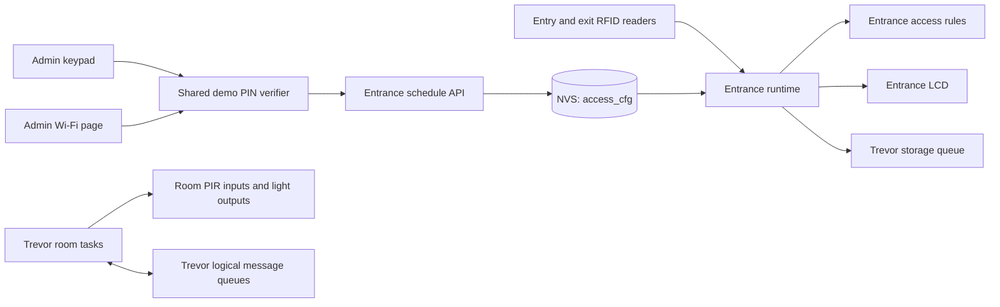

# Leon's implementation guide

This guide explains Leon's entrance-terminal work in small pieces. It also
records how the entrance and Trevor's room code share one ESP32 in the
presentation build without owning the same pins or state.

## The short version

- Leon owns entry/exit RFID decisions, building occupancy, the access schedule,
  the entrance LCD, admin keypad, and admin Wi-Fi page.
- Trevor owns the room sensors/lights and the room message/synchronization code
  in `components/trevor/`.
- `pio run -e esp32dev` is the combined Wokwi presentation build. It uses one
  ESP32 (`TR_ROLE=0`) and starts both runtimes.
- The `coordinator`, `room1`, and `room2` builds are separate physical-role
  builds for Trevor. They do not start Leon's entrance runtime because their
  UART pins overlap some entrance pins.
- Keep the code simple: each module has one job, entrance state has one owner,
  and other modules use the entrance API instead of editing that state.
- Leon's anti-passback alert, simulation-only tailgate marker and read-only
  evacuation report are implemented in firmware; see the system operation
  report for their behavior and limits.

## How the modules fit together



Everything shown runs on the same ESP32 in the default Wokwi build. The room
message queues are software queues in this simulation; they do not mean that
three physical ESP32 boards are present.

## Leon's modules and their jobs

| File or module | Keep its job this small |
| --- | --- |
| `components/entrance/core.c` | Decide whether a card event is valid, whether entry is in hours, and whether occupancy changes. Keep hardware and web code out of these rules. |
| `components/entrance/mfrc522.c` | Read the two MFRC522 readers over their shared SPI bus, check card replies and report UIDs. It should not decide who is authorized. |
| `components/entrance/runtime.c` | Own the live entrance state, time, event flow, and LCD refresh. It calls the core rules and publishes read-only status for other modules. The LCD is checked every 100 ms and written only when its text changes. |
| `components/entrance/display.c` | Draw four lines on the LCD. It should not change access decisions or the schedule. |
| `components/entrance/keypad.c` | Read keypad keys, ask the PIN verifier to authenticate, and send accepted time changes through the schedule API. It should not write the schedule state directly. |
| `components/entrance/dashboard.c` | Serve the admin page and status endpoints. It uses the same PIN verifier and schedule API as the keypad; it should not keep a second copy of the schedule. |
| `components/auth/runtime.c` | Check the presentation PIN with one PSA PBKDF2 derivation and apply the failed-login lockout. Do not put a plaintext PIN in logs or add a second login rule in the keypad or dashboard. |
| `include/common/system.h` | Hold data types shared across Leon's entrance and Trevor's room integration. Agree on changes before changing the message or event format. |
| `src/main.c` | Initialize shared NVS, start Trevor's runtime, and start Leon's runtime only for `TR_ROLE=0`. Do not move either subsystem's work into `main.c`. |

Trevor's code stays in `components/trevor/`. Leon should not rename, reformat,
or make feature edits to those files as part of entrance work. Use the published
`tr_runtime_*` APIs where integration is needed.

## Where Edward fits

Edward owns the persistent data and serial administration work. The simple
handoff is: Leon's entrance module owns access decisions and offers APIs;
Trevor's storage queue is the one writer; Edward supplies the storage and
command interfaces that use those APIs.

| Edward's assignment | Where it fits | Keep this boundary |
| --- | --- | --- |
| Save access, room and lighting events to SD | `components/storage/` implements the writer called by Trevor's storage task through `tr_storage_append()`. | Do not write to the SD card from RFID, room, keypad, dashboard or CLI tasks. Keep one SD writer and report missing/full-card errors through the existing counters. |
| Manage registered users | Edward's storage runtime loads and saves the roster, then calls `entrance_runtime_set_users()`. | Array indexes are stable user IDs. The entrance runtime remains the only owner of the live inside list and rejects a roster update that removes or replaces a person still inside. |
| Add serial status and record commands | The command layer is implemented in `components/cli/`. It reads entrance and room status through their public APIs. | Use the existing USB serial console (UART0); do not install a second UART0 driver. Trevor uses UART1/2 only in separate physical-role builds. |
| Require admin login for serial changes | The CLI uses the shared `components/auth/` verifier also used by the keypad and Wi-Fi page. | Keep one demo credential and lockout policy for all three interfaces; do not add a second PIN check in the CLI. |
| Persist schedule and its audit trail | The schedule API saves active hours to NVS namespace `access_cfg` and queues an old/new schedule audit row to the SD event log. | Keep one authoritative schedule and one write API. NVS remains the boot-time source of active hours; the SD row is the history record. |
| Choose an innovation feature | The repository now contains the safety bundle, feedback LED, empty-building light shutoff, room-link recovery, and room-light usage report. | Record which implemented feature or bundle the team will present as its formal innovation. |

Leon added the current PIN verifier only to make the presentation keypad and
dashboard work. Treat it as demo authentication, not Edward's finished
production admin system. If Edward changes authentication, he should preserve
one shared interface so keypad, Wi-Fi and serial login behave the same way.
Keep the authorship of each module explicit in commits and the report.

## What Leon is responsible for

Leon is responsible for the shared system interfaces, the combined circuit and
module setup, entrance access, occupancy, schedule, and integration. Keep each
item demonstrable:

1. **Shared contract:** define who owns each value, its units, and how other
   modules read or update it. The entrance runtime owns the people-inside list
   and access schedule; Trevor's room runtime owns room state.
2. **Circuit and module setup:** keep one ESP32 in `diagram.json`, keep its pins
   matched with the source, and build the default `esp32dev` environment.
3. **RFID access:** demonstrate a known card, an unknown card, and the correct
   reader. The current allowlist is two presentation users, not a user
  management system. Edward's store can supply its roster with
  `entrance_runtime_set_users()`; until then, the demo roster remains active.
4. **Occupancy:** allow a valid entry once, reject a second entry while that
   user is inside, allow their exit, and reject an exit when they are not inside.
5. **Hours and clock:** use Kampala local time from SNTP. Deny new entry if time
   is unknown or the schedule is closed. The same schedule blocks exits after
   closing; show the denied scan and unchanged inside count. Show people still
   inside in the close-time log.
6. **Admin schedule changes:** demonstrate keypad and Wi-Fi changes, validation
   of opening/closing times, lockout after repeated wrong PINs, and persistence
   after reboot. Both interfaces must call the same schedule API.
7. **Integration and report:** demonstrate Leon's entrance separately from
   Trevor's room subsystem, identify each author's work clearly, and record
   only results that were actually run.
8. **Release:** keep the work on the feature branch and PR, build the combined
   environment, and get the requested teammate review before merge.

### Remaining work to track honestly

- The earlier RFID probe detected the registered card at both readers. The
  earlier full Wokwi access flow ran after the 08:00-18:00 window and denied
  entry. A later Wokwi scenario passed a granted entry and exit and confirmed
  SD event writes.
- Grace's scan-feedback LED is integrated on GPIO12. It signals grant/deny with
  different pulse durations; it is not a door actuator.
- Edward's serial roster manager calls `entrance_runtime_set_users()` and saves
  the roster on SD with an NVS backup. Access and room events use the SD event
  writer; roster editing and CLI commands still need interactive Wokwi checks.
- The UART0 CLI provides queries, the read-only room-light `usage` report, and
  authenticated schedule/user operations.
  The `2468` PIN and HTTP page remain presentation-only authentication.
- Occupancy is volatile across reboot. The firmware marks it uncertain until
  an administrator confirms the building is empty after a physical check.
- The team still needs to record which implemented feature or bundle it will
  present as its innovation. Follow the lecturer's current Google Drive or
  GitHub submission-link instruction; a Wokwi link is optional.
- Keypad `B` marks a simulated tailgate and keypad `C` prints a read-only
  evacuation roll-call to the serial monitor. Schedule close prints the same
  report as an after-hours alert. Grace's blue LED indicates scan results; no
  door lock or buzzer is installed.

## One-chip rules that prevent interference

### Build mode

Use this for the combined presentation circuit:

```sh
pio run -e esp32dev
```

That environment sets `TR_ROLE=0`: Trevor simulates both rooms and the
coordinator with FreeRTOS queues; Leon runs the entrance terminal. Do not use a
physical-role environment with the combined entrance hardware. In those builds,
Trevor uses GPIO 16/17 for UART1 and GPIO 18/19 for UART2, which are assigned to
Leon keypad rows and RFID SPI. `main.c` therefore starts only Trevor's runtime
when `TR_ROLE` is 1, 2, or 3.

### Pin and bus ownership

| Resource | Owner and use | Rule for adding hardware |
| --- | --- | --- |
| GPIO 27, 26 | Trevor Room 1 PIR, light | Leave to Trevor. |
| GPIO 33, 25 | Trevor Room 2 PIR, light | Leave to Trevor. |
| GPIO 32 | Trevor logical-link switch | Leave to Trevor. |
| GPIO 18, 23, 19 | Shared SD/MFRC522 SPI2 bus: SCK, MOSI, MISO | SD initializes the 4096-byte shared bus first; each MFRC522 is added as a separate SPI device. |
| GPIO 5, 13; GPIO 4 | Leon entry CS, exit CS; shared reader reset | Keep the two chip selects separate. |
| GPIO 21, 22 | Leon LCD I2C SDA, SCL | Keep I2C access inside the display module unless another I2C device is deliberately added to the same bus. |
| GPIO 14-17 | Leon keypad row outputs | Do not use for LEDs or UART in the combined build. |
| GPIO 34, 35, 36, 39 | Leon keypad column inputs | These pins need the four external 10 kOhm pull-ups shown in the diagram. |
| GPIO 2 | Edward's SD chip select with a 10 kOhm pull-up | Keep the pull-up so chip select stays inactive at boot; storage initializes the shared SPI bus. |
| UART0 | USB serial logs for both modules | Both modules may print to the same console. Keep log lines short; interleaved logs do not mean the modules share state. |

The SPI driver serializes reader transfers. The LCD has its own I2C bus. The
keypad uses separate GPIOs. Trevor's room pins are separate from Leon's pins in
the `TR_ROLE=0` build. Do not call `gpio_config()` on another module's pins or
initialize a second driver on an already initialized bus.

### Shared state and storage

- The entrance mutex protects Leon's live access state. Read it with
  `entrance_runtime_status()` or `entrance_runtime_snapshot()`; change schedule
  only with `entrance_runtime_set_schedule()` after authentication.
- Trevor owns room state and protects it through Trevor's APIs and queues. Do
  not read or modify Trevor's private variables from the entrance code.
- Both runtimes use the one default NVS partition. Trevor stores its boot count
  under namespace `trevor_link`; Leon stores hours under `access_cfg`. Keep
  these names separate. Never erase NVS during a module restart or schedule
  update because that would delete the other module's settings too.
- Entrance access events use `tr_runtime_record_access_durable()`. It queues
  the event and waits up to five seconds for the storage worker to report its
  SD write result. Do not write SD data directly from an RFID, keypad, or
  dashboard task.
- FreeRTOS tasks share one CPU. Keep loops delayed, use the module's mutex/API
  for shared state, and do not add long waits while holding a mutex.

## Simple code habits

1. Give each function one job and use names that say what the value means.
2. Keep access rules in `core.c`; keep pins and device commands in the hardware
   module; keep coordination in `runtime.c`.
3. Do not duplicate state. The schedule has one copy in the entrance runtime;
   the LCD and dashboard display snapshots of it.
4. Keep errors visible. If clock sync, RFID, LCD, storage, or Wi-Fi fails, log
   the failure and avoid pretending the operation succeeded.
5. Explain why a non-obvious rule exists in a short comment. Avoid comments
   that just repeat each line of code.
6. Keep Leon's report and commits attributed to Leon. Keep Trevor's module and
   report contribution attributed to Trevor.

## Before asking for review

From the coursework directory:

```sh
git fetch origin
git status --short --branch
git merge-base --is-ancestor origin/main HEAD
pio run -e esp32dev
python3 -m json.tool diagram.json >/dev/null
git diff --check
```

If the `merge-base` command fails, merge the latest `origin/main` into the
feature branch, resolve only the files that actually conflict, then repeat the
build and diagram checks. Do not force-push or merge directly to `main`. Check
the PR's mergeability again after every push; a mergeable PR is a current
snapshot, not a guarantee that future changes cannot conflict.

The feature branch must include the latest `origin/main` before merge. PR #22
was checked during this guide update; check its mergeability again after this
guide and the start-mode guard are pushed, and again immediately before merge.
