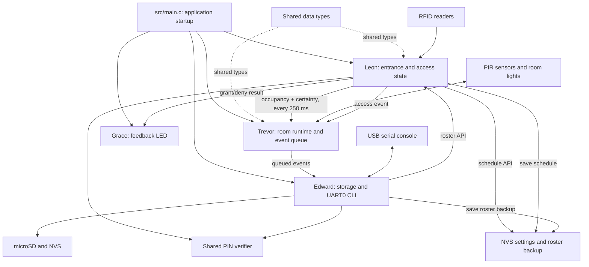

# Module Integration Guide

This guide follows the connections between the team members' modules. It shows
which module owns each decision, what information crosses the boundary, and
how the same flow works on the combined Wokwi board.

## 1. Integration overview

The arrows show API or event flow, not direct access to another module's
private variables. The public functions and shared data types are documented in
`docs/INTERFACES.md`.

## 2. Who owns which state

| Information | Owner | How other modules use it |
| --- | --- | --- |
| Which registered person is inside | Leon's entrance runtime | Read a snapshot or use the count bridge; do not edit its array directly. |
| Current access schedule | Leon's entrance runtime | Authorized clients call the shared schedule API. |
| Registered roster files | Edward's storage module | Entrance loads the roster; CLI requests validated roster updates. |
| Room motion/light/link state | Trevor's room runtime | CLI reads a room snapshot; entrance provides only the building occupancy safety input. |
| Event files on SD | Edward's storage module | Trevor's single writer task calls the storage append API. |
| Scan-feedback LED | Grace's actuator module | Entrance calls a function with `granted=true/false`. |
| PIN failure/lockout data | Shared auth module | Keypad, dashboard, and CLI call the same PIN verification function. |

This ownership rule prevents each interface from keeping its own copy of a
schedule or occupancy count.

## 3. One accepted RFID scan, end to end

1. An MFRC522 reader sends the UID over SPI. The entry and exit readers share
   SPI data and clock pins but use different chip-select pins.
2. Leon's entrance task identifies the reader side and calls the entrance core
   rules with the UID, clock validity, and current schedule minute.
3. The rules find the enabled roster entry, reject invalid transitions, and
   apply the schedule to both entry and exit. If allowed, the inside list and
   count are updated. If denied, occupancy stays as it was.
4. The entrance reports the outcome to the LCD and serial log and calls Grace's
   feedback function. The LED uses a short pulse for a grant and a longer pulse
   for a denial.
5. The entrance serializes the event into the access event format and offers
   it to Trevor's bounded event queue. The entrance waits up to five seconds
   for the storage worker's result.
6. Trevor's storage worker removes the event from the queue and calls Edward's
   storage append API. Edward writes a readable row to the SD CSV, flushes and
   syncs it, then closes the file under the file mutex. The worker reports
   success or failure to the entrance task.
7. The occupancy bridge copies the new inside count and whether it is
   authoritative to Trevor's room runtime within about 250 ms. If it is a known
   zero, the room rule forces the room lights off.

## 4. Room update, communication, and diagnostics

Each Trevor room task samples one PIR sensor and controls its own light output.
The task calculates an off-delay, creates a room-state message, and sends it
to the coordinator. The message carries room ID, boot session, sequence,
uptime, motion, light state, and delay. The receiver checks the frame and
rejects duplicate or stale state, then returns an acknowledgement.

For `TR_ROLE=0`, bounded FreeRTOS queues model the room links on the one-chip
presentation board; GPIO32 controls the simulated link state. The physical
coordinator and room roles use UART. The sender retries an unacknowledged frame
and tracks retries, timeouts, transport drops, and stale frames. Local room
lighting continues if communication is interrupted.

The coordinator offers new room state as a storage event. Trevor's single
storage worker handles room, access, and schedule events in order. Edward's CLI queries
Trevor's snapshot for the `rooms`, `status`, and `usage` commands. The room
usage counters report time and do not estimate kWh.

## 5. Administration flow

The keypad, dashboard, and serial CLI use the shared authentication module.
After a correct PIN, the selected interface calls Leon's schedule API. The API
validates the start/end times, commits them to NVS, changes the runtime schedule
used by both readers, then queues an SD audit row with the old and new values.
The caller waits for the storage result. This is one shared schedule; the
interfaces do not implement separate copies of access logic. If the SD write
fails, NVS still contains the new active schedule and the firmware reports that
the audit row was not confirmed.

For roster changes, Edward's CLI asks the entrance runtime for a snapshot,
validates the proposed new roster through Leon's API, and asks storage to save
it. Storage writes a backup to NVS and the roster file to SD. If saving fails,
the CLI restores the previous live roster. A person recorded inside cannot be
removed. The keypad and dashboard currently provide schedule administration;
the serial CLI provides schedule and roster administration.

After a reboot, the saved roster and schedule can be reloaded, but the inside
list is volatile. Staff must physically check the building before an admin
confirms it empty. A simulated tailgate alert also makes occupancy uncertain;
it does not add or remove a person from the list.

## 6. Bus and interface integration

- **SPI:** Edward's storage initialization starts the shared bus. The two RFID
  readers use that same bus with separate chip selects. Drivers must leave
  unselected devices inactive.
- **I2C:** Leon's display driver updates the LCD on the shared I2C pins.
- **UART0:** Edward's CLI reads commands from the USB console, which also shows
  ESP-IDF logs. Trevor physical roles use separate UART links so they do not
  consume the entrance's presentation wiring.
- **FreeRTOS queues:** pass room frames and events between producers and
  consumers without direct file writes from sensor and RFID tasks.
- **FreeRTOS mutexes:** protect shared state and files during short read/write
  sections.

## 7. Integration presentation route

To explain how the parts work together, present one flow in this order:

1. Point to `src/main.c` and explain it starts each owner's module.
2. Show a registered RFID scan and identify Leon's access decision.
3. Show the LED outcome and name Grace's actuator API.
4. Show the count changing and explain the 250 ms bridge to Trevor's empty-
   building light rule.
5. Trigger room motion and explain Trevor's task, off-delay, message, and
   status counters.
6. Show the CLI reading the room/occupancy snapshot and the `records` command
   reading the SD log.
7. Explain that an event goes through Trevor's queue and one writer before
   Edward's storage code touches the file.
8. Demonstrate or describe an authorized schedule change and identify the
   shared authentication and schedule APIs.

For the full operation sequence, see [`CODE_WALKTHROUGH.md`](CODE_WALKTHROUGH.md).
