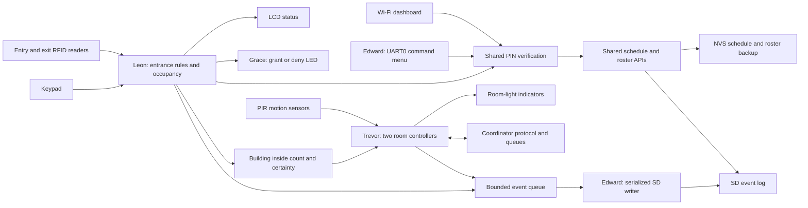

# CoCIS Smart Control and Monitoring System

## System Operation Report

**Prepared:** 2 November 2026
**Coursework:** Embedded Systems
**Project repository:** [Embedded-Course-Work](https://github.com/ledge-stack/Embedded-Course-Work)
**Submission format:** GitHub or Google Drive link, as accepted by the lecturer

## Executive Summary

The CoCIS Smart Control and Monitoring System demonstrates access control at
the college entrance and automatic lighting for two lecture rooms. At the
entrance, two RFID readers distinguish entry from exit. The firmware checks
whether a card belongs to an enabled user, whether the person is already
recorded inside, whether the clock is synchronized, and whether the current
time is within the configured access schedule. Accepted access changes the
inside list; denied access leaves it unchanged.

The room modules read two PIR motion sensors and control two light indicators.
Each room applies an off-delay after motion stops. The entrance's building
count is also supplied to the room controller. If the count is confirmed as
zero, the room lights are forced off. If occupancy is uncertain, the system
does not assume the building is empty.

The system provides an LCD, administrator keypad, Wi-Fi dashboard, UART0
command menu, blue scan-feedback LED, microSD event log, and FreeRTOS
synchronization. The active access schedule is saved in ESP32 NVS. Access
history and schedule-change audit rows are appended to the SD card. A successful
access or schedule audit request waits for the storage task to report that the
row was written and synced.

The presentation circuit in `diagram.json` uses **one ESP32**. The entrance,
two rooms, and coordinator run as separate software modules/tasks on that
board. Separate PlatformIO builds exist for coordinator, room 1, and room 2,
but the diagram is not a three-board physical network.

## 1. Project Purpose and Objectives

The system models selected security, monitoring, and energy-management
functions for the CoCIS building. Its objectives are to:

1. Identify registered people using RFID cards at separate entry and exit
   points.
2. Keep a list and count of people accepted into or out of the building.
3. Enforce a configurable opening and closing schedule at both doors.
4. Control two lecture-room light outputs from PIR motion sensing and an
   off-delay.
5. Prevent room lights from remaining on when the building is confirmed empty.
6. Save access, room, user, and schedule information using the SD card and
   non-volatile ESP32 storage.
7. Provide useful status and management commands over the serial interface.
8. Protect shared data and storage operations while multiple FreeRTOS tasks
   run.

### Requirements and implementation status

| Coursework requirement | Current implementation | Important boundary |
| --- | --- | --- |
| Automated access control | Entry and exit RFID scans are checked against the roster, inside list, clock, and schedule. | The indicators do not operate a real door lock. |
| RFID identification | Two MFRC522 readers use separate chip-select pins on a shared SPI bus. | Demo UIDs are provided when no saved roster is available. |
| Occupancy monitoring | The entrance keeps a live list and count based on granted RFID transitions. | This is a logical count; it does not detect tailgating or independently count people. |
| Intelligent room lighting | Two PIR/light channels use an off-delay and an empty-building override. | PIR reports motion, not room headcount. |
| Data storage | Access and room events go to SD; roster and schedule are stored persistently. | Live inside state and runtime usage counters reset at reboot. |
| Configurable schedule | Authorized keypad, dashboard, or CLI changes use one schedule API. | The clock must be synchronized before access is allowed. |
| Authorized configuration | PIN verification, a one-minute failed-login lockout, and short admin sessions protect changes. | The four-digit PIN and HTTP dashboard are demonstration features. |
| Resource synchronization | FreeRTOS queues and mutexes coordinate tasks; access/config writes receive a storage result. | Room-state logging is asynchronous and can be dropped if its queue fills. |

## 2. System Architecture

### High-level information flow



### Software boundaries

The program is split into modules so that each type of state has one clear
owner. Other modules use public functions declared in `include/` instead of
modifying another module's private variables.

| Area | Source location | Main responsibility |
| --- | --- | --- |
| Application startup | `src/main.c` | Starts the combined application and bridges entrance occupancy into room control. |
| Entrance and access | `components/entrance/`, `include/entrance/` | RFID drivers, access rules, user-inside state, schedule, LCD, keypad, dashboard, and event handoff. |
| Room sensing and transport | `components/trevor/`, `include/trevor/` | PIR sampling, light timing, room state messages, retries, diagnostics, queues, and usage counters. |
| Storage | `components/storage/`, `include/storage/` | Shared SPI initialization, SD mount, event append, and roster load/save. |
| Serial menu | `components/cli/`, `include/cli/` | UART0 command parsing, status queries, login, schedule commands, and roster commands. |
| Feedback actuator | `components/actuator/`, `include/actuator/` | Grant/deny pulse on the blue LED. |
| Authentication | `components/auth/`, `include/auth/` | Shared PIN verifier and failed-attempt lockout. |
| Shared data | `include/common/` | User, event, access result, schedule, and protocol data types. |

`components/rooms/` and `components/comms/` are ESP-IDF interface boundaries
for Trevor's implementation; they do not contain duplicate room logic.
`components/common/` is a build boundary, while shared data types are declared
in `include/common/system.h`.

### Application startup and integration

ESP-IDF calls `app_main()` in `src/main.c`. In the combined `TR_ROLE=0`
presentation build, startup proceeds in this order:

1. Initialize NVS, which stores persistent settings.
2. Start Edward's storage module. It initializes SPI2 and attempts to mount the
   microSD card at `/sdcard`.
3. Start Trevor's room runtime. It initializes the room inputs/outputs and
   creates the room, coordinator, status, and storage tasks.
4. Start Grace's actuator interface and configure the feedback LED.
5. Start Leon's entrance runtime. It loads the schedule, initializes both RFID
   readers and the LCD, then starts the clock, RFID, schedule-monitor, display,
   and keypad tasks.
6. Load a saved roster from SD or NVS when one exists. On a clean install, the
   demo roster maps Blue (`DE:AD:BE:EF`) to Leon, Green (`11:22:33:44`) to
   Trevor, Yellow (`55:66:77:88`) to Edward, and Red (`AA:BB:CC:DD`) to Grace.
7. Start an occupancy bridge. Every 250 ms it reads the entrance count and
   certainty and passes them to Trevor's room runtime.
8. Start Edward's serial menu on UART0 at 115200 baud.

If SD mounting fails, the firmware reports the problem. NVS-backed schedule
and roster information remain available, but event history cannot be appended
until SD storage is available. Local room and entrance code continues to run.

## 3. Hardware and Pin Layout

The combined circuit contains one ESP32 development board, two MFRC522 RFID
readers, a 20x4 I2C LCD, a 4x4 keypad, two PIR sensors, two room-light LEDs, a
simulated room-link switch, a microSD card, and a blue feedback LED.

| Component or signal | GPIO | Purpose and connection |
| --- | ---: | --- |
| Room 1 PIR | 27 | Reports motion in lecture room 1. |
| Room 1 light | 26 | Shows the room 1 light output state. |
| Room 2 PIR | 33 | Reports motion in lecture room 2. |
| Room 2 light | 25 | Shows the room 2 light output state. |
| Simulated room-link switch | 32 | Interrupts or restores the logical room/coordinator link. |
| SPI SCK / MOSI / MISO | 18 / 23 / 19 | Shared clock and data for RFID readers and microSD. |
| Entry reader CS / reset | 5 / 4 | Selects the entry MFRC522; reset is shared. |
| Exit reader CS / reset | 13 / 4 | Selects the exit MFRC522; reset is shared. |
| microSD chip select | 2 | Selects the SD card on the shared SPI bus. |
| LCD SDA / SCL | 21 / 22 | I2C connection to the LCD. |
| Keypad rows | 14, 15, 16, 17 | ESP32 drives one keypad row at a time. |
| Keypad columns | 34, 35, 36, 39 | ESP32 reads keypad columns; external pull-ups are required. |
| Feedback LED | 12 | Short grant pulse or longer deny pulse. |
| USB serial | UART0 | Logs and serial commands at 115200 baud. |

### Bus sharing and electrical notes

The two MFRC522 readers and SD card share SPI clock and data lines. Each has a
separate chip-select signal so only the selected device communicates. The LCD
uses I2C. The keypad's GPIO34, GPIO35, GPIO36, and GPIO39 inputs do not provide
internal pull-ups, so the circuit uses external pull-up resistors. GPIO2 and
GPIO12 are ESP32 boot-strapping pins; the diagram includes pull resistors to
define startup levels.

The room LEDs and feedback LED are visual indicators. They are not suitable for
driving mains lights or door locks. Pin selection, resistor values, power
levels, and boot behavior must be checked before moving from Wokwi to a
physical board. The complete interface is recorded in
[`INTERFACES.md`](INTERFACES.md).

## 4. Detailed System Operation

### 4.1 Clock and schedule preparation

The access schedule defaults to 08:00–18:00 Africa/Kampala time. The entrance
connects to the Wokwi guest network and synchronizes the clock with SNTP. The
system does not guess the current time: until synchronization succeeds, it
denies entry and exit. The schedule uses local minutes after midnight. A normal
interval includes its start time and excludes its end time; overnight hours
such as 22:00–06:00 are also supported, while equal start and end times are
rejected.

The stored active schedule is in NVS namespace `access_cfg`. For example,
23:00 is stored as 1,380 minutes after midnight and loaded during startup. When
an administrator changes the hours, the runtime commits the new schedule to
NVS, then queues a schedule audit event for the SD card. The audit row records
the previous and new opening/closing hours. The SD row provides history; NVS is
the authoritative schedule source after reboot.

### 4.2 RFID access decision

The entry and exit readers use the same RFID driver but are assigned different
reader numbers. The entrance task polls both readers and suppresses repeated
reads while the same card is held against a reader. For each new scan, the
entrance rules check the UID against the enabled user roster and then apply the
state and time rules.

| Condition | Decision | Effect on inside list |
| --- | --- | --- |
| UID is not registered or user is disabled | Deny | No change. |
| Entry scan for a person already inside | Deny as anti-passback | No change. |
| Exit scan for a person not recorded inside | Deny as invalid exit | No change. |
| Clock is not synchronized | Deny | No change. |
| Current time is outside access hours | Deny | No change. This applies to both doors. |
| All checks pass at entry | Grant entry | Mark the user inside. |
| All checks pass at exit | Grant exit | Mark the user outside. |

After a denied exit outside the schedule, the person remains recorded inside.
At closing time the schedule monitor reports names still recorded inside. The
inside list is based on granted card transitions; RFID does not detect someone
following a cardholder. Keypad `B` is a labelled simulation-only tailgate
warning. It marks occupancy uncertain but does not add a person to the list.
Keypad `C` prints a read-only roll-call of names to the serial console.

### 4.3 Access feedback and display

The LCD is a 20x4 display. It shows whether the building is open, the schedule,
the most recent access result, and the recorded inside count. After an accepted
entry it briefly shows `Welcome` and the person's first name; after an accepted
exit it briefly shows `Goodbye` and their first name. A denied scan shows the
name with a denial message. It also shows occupancy uncertainty after a reboot
or simulated tailgate alert and an after-hours alert if people remain inside.

Grace's blue LED receives a grant/deny signal from the entrance module. A
granted scan produces a short pulse; a denied scan produces a longer pulse.
The LED is a feedback indicator only and has no connection to a door lock.

### 4.4 Administrator interfaces

The keypad, Wi-Fi dashboard, and UART0 CLI share the same PIN verification and
schedule API. The keypad flow is:

1. On the public screen press `A`.
2. Enter the four-digit demo PIN `2468` and press `#`.
3. Press `1` to change opening time, `2` to change closing time, `3` to page
   through the registered roster, or `4` to page through recent entry/exit
   attempts. The roster shows `IN`, `OUT`, or `OUT?` while occupancy is
   uncertain. In either list, `A` and `B` move between pages and `D` returns to
   the admin menu; `D` in the menu logs out.
4. To change a time, enter four digits in `HHMM` format, then press `#`. For
   example, `2300`
   means 23:00. `*` clears the input and `D` cancels or logs out.

After an access scan, the public LCD briefly welcomes a person who entered or
says goodbye to someone who exited. The admin dashboard presents the full
registered roster and recent scan activity. The keypad roster and activity
views require the admin PIN. Recent activity in RAM resets at reboot; the SD
event file keeps the longer access history when the card is available.

The serial CLI provides read-only commands for status, occupancy, rooms, light
usage, users, event records, and schedule. After `login 2468`, an administrator
can use `open HH:MM`, `close HH:MM`, `useradd NAME UIDHEX`, `userdel ID`, and
`confirm-empty`. A user recorded inside cannot be removed. Keypad and CLI admin
sessions expire after 60 seconds. The Wi-Fi dashboard requires Wokwi's Private
IoT Gateway for access from a host browser.

### 4.5 Room sensing and light control

Trevor's room runtime creates a task for each room. The task samples its PIR
input, updates the room state, and controls only that room's light output.
Motion turns the light on. When motion stops, a five-second off-delay keeps the
light on; renewed motion restarts the delay. The off-delay is configurable in
the room runtime, with a maximum of one hour.

Room motion is not building occupancy. The occupancy bridge supplies a separate
building count from Leon's entrance module. When that count is authoritative
and zero, the effective light output is forced off even if a local light
request exists. When the count is unknown, the system does not apply the
empty-building override. If the simulated link fails, room-local sensing and
lighting continue while remote state becomes stale and retry/timeout counters
change.

The serial `usage` command reports time each room light was on and time a light
request was suppressed by the known-empty rule since the latest boot. These
values are durations only. The system does not measure electrical current or
calculate kilowatt-hours.

## 5. Persistence and Records

The system uses RAM, NVS, and the microSD card for different purposes:

| Information | Storage location | Behavior after power loss or restart |
| --- | --- | --- |
| Active opening/closing schedule | ESP32 NVS, namespace `access_cfg` | Loaded again during entrance startup. A 23:00 closing time remains active if its NVS commit succeeded. |
| Registered-user roster | `/sdcard/users.bin`, with NVS backup | Loaded from SD when valid; NVS is fallback. |
| Access attempts and decisions | `/sdcard/events.csv` | New records are appended, flushed, synced, and closed before the access caller receives a successful storage result. |
| Schedule-change audit rows | `/sdcard/events.csv` | Records old and new times after the NVS schedule commit. If SD logging fails, NVS still keeps the active schedule and a warning is logged. |
| Room state events | `/sdcard/events.csv` | Queued asynchronously by the room runtime; queue drops and write failures are counted. |
| Live inside list and usage counters | RAM | Reset at reboot. The inside count becomes uncertain; usage durations restart at zero. |

New access rows contain an event ID, Kampala date/time, display name, entry or
exit, grant/deny result, UID, stable user ID, inside count, UTC epoch, and
monotonic uptime. New schedule rows show the old and new hours. For example:

```text
ACCESS,event_id,Kampala_time,"person",ENTRY,GRANTED,UID,user_id,inside_count,utc_epoch,uptime_ms
SCHEDULE,Kampala_time,OPEN=old->new,CLOSE=old->new
```

Access and schedule audit writes travel through Trevor's 16-item storage queue
and single storage worker. The caller waits up to five seconds for a result.
Edward's storage code holds the filesystem mutex, writes the row, calls
`fflush()` and `fsync()`, and closes the file before reporting success. If the
queue is full, the card is absent/full, or a write fails, the firmware reports
that the row was not confirmed. The active schedule remains in NVS even when
its SD audit write fails.

The event file is append-only in normal operation: new firmware does not erase
older records. Records written by earlier firmware may still use the compact
hexadecimal format; they remain in the file but are not converted automatically
to the newer readable format. A schedule change made before the audit format
was introduced is not inserted retroactively. Saving the schedule again writes
a new audit row.

An SD card cannot record data when it is missing, damaged, full, or disconnected.
The firmware exposes availability and failure counters, but no software can
promise an SD write succeeded after the storage API reported an error. The
reported successful path confirms the filesystem has flushed the event before
the scan handler returns; a power cut during a card transaction still needs a
live failure test.

## 6. Serial Menu Reference

The CLI reads commands from the USB serial console at 115200 baud. ESP-IDF log
messages use the same UART0, so command output and diagnostics may appear
together.

| Command | Purpose | Authentication |
| --- | --- | --- |
| `help` | Print available commands. | Not required. |
| `status` | Show entrance state, clock readiness, SD availability, and storage counters. | Not required. |
| `inside` | Show inside count and recorded occupants. | Not required. |
| `rooms` | Show online state, motion, light state, and off-delay for both rooms. | Not required. |
| `usage` | Show light-on and empty-building-suppressed time since boot. | Not required. |
| `users` | Show registered users and their stable slot IDs. | Not required. |
| `records` | Print records stored in the SD event file. | Not required. |
| `schedule` | Print current Kampala opening and closing hours. | Not required. |
| `login 2468` / `logout` | Start or end the temporary admin session. | PIN required for login. |
| `open HH:MM` / `close HH:MM` | Change schedule hours. | Admin session required. |
| `useradd NAME UIDHEX` | Add a registered card. | Admin session required. |
| `userdel ID` | Remove a roster slot. | Admin session required; occupied users cannot be removed. |
| `confirm-empty` | Confirm the building is physically empty after a check. | Admin session required. |

The demo PIN is `2468`. The PIN verifier uses PBKDF2-HMAC-SHA-256 with 1,000
rounds and compares the derived value without stopping at the first mismatch.
Five failed attempts cause a one-minute lockout. This is useful for the
coursework demonstration, but a four-digit PIN and HTTP dashboard are not
production-grade authentication.

## 7. FreeRTOS Tasks and Synchronization

FreeRTOS lets the ESP32 schedule different activities as independent tasks.
Tasks share one system, so the modules use queues and mutexes to coordinate
access to shared data and slow operations.

| Task or activity | Approximate behavior | Responsibility |
| --- | --- | --- |
| `entrance_rfid` | Polls readers about every 100 ms. | Detects cards, decides access, emits events, and updates feedback. |
| `entrance_lcd` | Refreshes about every 100 ms when display contents change. | Renders entrance, schedule, last event, and occupancy. |
| `entrance_keypad` | Scans about every 40 ms. | Reads keys and runs the public/admin keypad state machine. |
| `entrance_schedule` | Checks about every 15 seconds. | Detects a schedule closing and reports occupants still inside. |
| `entrance_clock` | Waits for network time and checks time about every five seconds. | Connects Wi-Fi, starts SNTP, and marks clock readiness. |
| `tr_room` | Samples each owned room about every 20 ms. | Reads PIR, applies off-delay and empty-building rule, controls the light, and sends room state. |
| `tr_coord` | Checks room messages about every 20 ms. | Validates new state, handles acknowledgements, and publishes snapshots. |
| `tr_store` | Blocks until an event arrives. | Is the single consumer for room, access, and schedule events. |
| `tr_status` | Prints diagnostics about every two seconds. | Shows room state, retry/timeout counts, queue drops, and failed writes. |
| `occupancy_bridge` | Runs about every 250 ms. | Passes entrance count and certainty to Trevor's room runtime. |
| `edward_serial_cli` | Waits for a command line. | Parses UART0 commands and calls module APIs. |

### Queues

A queue is a first-in, first-out mailbox. Producers put complete messages or
events into it; a consumer removes them later. In the combined demo, bounded
queues of eight frames in each direction model each room link. The event queue
holds up to 16 events. Producers use non-blocking sends so room timing is not
held up by an SD write. A full queue increments a drop counter.

### Mutexes

A mutex is a lock around a shared value. The entrance mutex protects its live
schedule, roster, and inside state. Trevor's mutex protects room snapshots and
counters. The keypad/dashboard/auth modules protect their UI, session, or PIN
lockout state. The storage file mutex prevents a CLI read, roster write, and
event append from using the SD file at the same time. The lock is released
before slow or unrelated work wherever possible.

The code calls `xSemaphoreTake()` and `xSemaphoreGive()` because FreeRTOS
provides mutexes through its semaphore API. This project uses mutex-type
semaphores for mutual exclusion; it does not currently use a separate binary or
counting semaphore.

### Task notifications

After an access or schedule event is queued, its caller waits up to five seconds
for a task notification from the storage worker. The notification carries the
write result back to the task that requested it. Room-state events remain
asynchronous. This distinction lets the entrance confirm its important record
was synced without making the room-control task wait for storage.

## 8. Member Contributions

| Member | Contribution presented in this project | Main code area |
| --- | --- | --- |
| **Leon Nsitta Kalungi** | Project setup and integration; entry/exit RFID, access rules, anti-passback, inside tracking, Kampala schedule, time handling, LCD, keypad, dashboard, roll-call, and access-event handoff. | `components/entrance/`, `include/entrance/`, `src/main.c` |
| **Kato Trevor** | Two room PIR/light channels, off-delay, room protocol, sequence and checksum checks, acknowledgements, retries, synchronization diagnostics, bounded event queue, single storage worker, building-empty safety rule, and light-use counters. | `components/trevor/`, `include/trevor/` |
| **Kagimu Edward** | Shared SPI and SD-card interface, event logging, roster file and NVS backup, UART0 query menu, records reader, and authenticated schedule/user administration. | `components/storage/`, `components/cli/`, `include/storage/`, `include/cli/` |
| **Ahurira Grace** | Blue access-feedback LED interface with different pulse lengths for grants and denials, plus its wiring contract. | `components/actuator/`, `include/actuator/` |

### Member identification details

| Member | Registration/student identification |
| --- | --- |
| Leon Nsitta Kalungi | Registration No. `25/U/24111`; Student No. `2500724111` |
| Kato Trevor | To be supplied by the member. |
| Kagimu Edward | To be supplied by the member. |
| Ahurira Grace | To be supplied by the member. |

The presentation guide folder contains a separate speaking outline for each
member. Each person should check their identification details and be ready to
explain their assigned code area.

## 9. Innovation and Additional Features

The system combines several features that add safety and information beyond
basic card scanning and motion-triggered lights:

- **Anti-passback and invalid-exit alerts:** repeated entry and exit without a
  recorded entry are rejected and logged.
- **After-hours occupancy report:** the schedule monitor reports people still
  recorded inside when the access window closes.
- **Simulated tailgate uncertainty:** keypad `B` marks occupancy as uncertain
  for staff review. It does not alter the inside list and is not an automatic
  tailgate sensor.
- **Read-only evacuation roll-call:** keypad `C` prints the recorded names and
  count without exposing card UIDs.
- **Empty-building light override:** known-zero building occupancy forces both
  room light outputs off.
- **Link recovery and diagnostics:** room messages use sequences,
  acknowledgements, retries, stale detection, and online/offline status.
- **Light-use duration report:** the CLI estimates runtime and suppressed
  runtime, but does not claim energy savings in kWh.
- **Persistent schedule and audit trail:** NVS retains the active schedule,
  while SD rows record changes and access events.

## 10. Verification Evidence and Known Limits

### Build evidence

The current firmware builds successfully in all four PlatformIO environments:
`esp32dev`, `coordinator`, `room1`, and `room2`. The `esp32dev` environment
(`TR_ROLE=0`) is the combined one-ESP32 presentation target. A successful build
shows that the code compiles and links; it does not prove every simulated or
physical interaction.

### Previously observed Wokwi behavior

The completion record documents a Wokwi run in which the SD card mounted, a
registered green demo card entered and exited during open hours, occupancy
returned to zero, and two access records were written. A separate after-hours
scenario detected the registered UID `11223344` and denied entry because the
schedule was closed, then rejected the unregistered Key Fob UID `C0FFEE99`.

Those Wokwi runs used the earlier compact access-record format. The current
firmware compiles with readable access rows, schedule-change audit rows, and a
storage completion response. A fresh Wokwi run and power-cycle check are still
needed to demonstrate these latest storage changes end to end. The full
expanded presentation scenario, roster reboot restoration, SD full/removal
recovery, room-link recovery, empty-building lighting, and visual LED feedback
also need their own live demonstrations; see
[`COURSEWORK_COMPLETION_PLAN.md`](COURSEWORK_COMPLETION_PLAN.md).

### Scope and limitations

- The supplied Wokwi diagram models one ESP32 with logical room/coordinator
  tasks, not three physically wired ESP32 terminals.
- The RFID inside list is not restored after reboot. It is marked uncertain so
  staff can check the building before confirming it empty.
- The event log does not reconstruct occupancy by replaying past access rows.
- A simulated tailgate alert is not a real sensor and cannot identify the
  person who followed a cardholder.
- PIR sensors detect motion, not the exact number of people in a room.
- Feedback and room LEDs are indicators; they do not operate real locks or
  mains lighting.
- The demo PIN and HTTP dashboard are not production authentication.
- SD persistence depends on an available, writable card. Failed writes are
  counted and logged; the application reports when a record was not confirmed.
- Room usage values are durations only, not measured electrical energy.

## 11. Supporting Documents

- [Repository structure guide](REPOSITORY_STRUCTURE_GUIDE.md)
- [Code and system walkthrough](CODE_WALKTHROUGH.md)
- [System principles guide](SYSTEM_PRINCIPLES_GUIDE.md)
- [Module integration guide](MODULE_INTEGRATION_GUIDE.md)
- [Individual presentation guides](presentations/README.md)
- [Presentation demo sequence](PRESENTATION_DEMO.md)
- [Interfaces and pin contract](INTERFACES.md)
- [Coursework completion plan and evidence](COURSEWORK_COMPLETION_PLAN.md)
