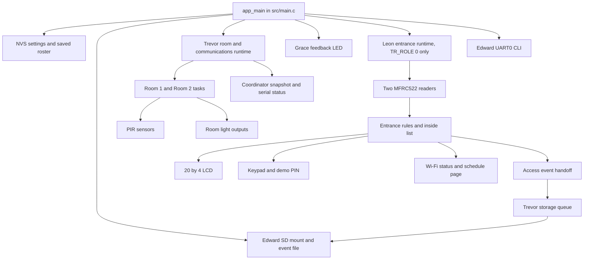

# How the CoCIS Smart Control System Runs

## Lecturer presentation guide

**Prepared for:** Coursework presentation
**Current implementation status:** 1 November 2026

This guide explains the project from power-on to the final status reports. It
uses simple language and follows the system in the order a presenter can show
it. The combined `esp32dev` presentation build uses one ESP32: Leon's entrance
terminal runs beside Trevor's two simulated room terminals and coordinator.
The project also has separate builds for the coordinator, Room 1 and Room 2.

Earlier evidence in the project records all four PlatformIO role builds and an
RFID-reader probe. The combined `esp32dev` build now includes the SD storage
component, serial CLI, feedback LED and occupancy safety bridge. The 1 November
Wokwi scenario mounted the SD card, granted a green-card entry and exit during
open hours, returned occupancy to zero, and wrote both access events. The
separate CLI, keypad/dashboard, empty-building shutdown and visual LED checks
still need their own demonstrations. Tell the lecturer which results came from
a build, host test or an actual Wokwi session.

## 1. A short explanation to open the presentation

> “This project controls access at the CoCIS entrance and switches two lecture
> room lights when motion is detected. At the entrance, two RFID readers
> represent entry and exit. The controller checks the card, the person's
> recorded inside status and the access hours. It shows the result on an LCD
> and sends room events through a shared software interface. Each room has its
> own small controller routine. FreeRTOS lets the entrance, rooms, display,
> keypad, schedule checker and storage queue make progress independently while
> mutexes protect shared data.”

Then explain this important limit:

> “For the presentation build, the three logical roles run on one ESP32. This
> lets us demonstrate the behavior in one Wokwi circuit, but it does not prove
> the wiring or UART communication between three separate physical boards.”

## 2. The system from power-on to operation

### Step 1: ESP-IDF starts the application

The ESP32 begins in [`src/main.c`](../src/main.c). The entry function is named
`app_main()` because this is an ESP-IDF application.

1. `nvs_flash_init()` starts Non-Volatile Storage (NVS), the ESP32's small
   persistent settings area.
2. In the combined demo, `storage_runtime_start()` initializes the shared SPI
   bus and tries to mount the SD card. Failure is logged; local control may
   continue without event persistence.
3. `tr_runtime_start()` starts Trevor's room and communications runtime and
   its one-consumer storage queue.
4. With `TR_ROLE` set to `0`, `actuator_runtime_start()` prepares Grace's
   feedback LED, then `entrance_runtime_start()` starts Leon's runtime. A saved
   roster is loaded from NVS if one exists.
5. `occupancy_bridge_task` passes Leon's inside count to Trevor's room runtime
   every 250 ms. `cli_runtime_start()` starts Edward's UART0 command reader.

`ESP_ERROR_CHECK()` checks each startup result. If a required subsystem cannot
start, the firmware stops with an error instead of pretending the whole system
is ready. In the separate roles (`TR_ROLE` 1, 2 or 3), Leon's entrance runtime
is not started because Trevor uses some UART pins that overlap Leon's keypad
and RFID pins.

### Step 2: Trevor prepares the room roles

Trevor's runtime in [`components/trevor/runtime.c`](../components/trevor/runtime.c)
creates the shared-state mutex and a storage queue. In the combined demo it
also creates software queues that stand in for the room communication links.
It sets the room light outputs off before creating the background tasks.

The two room tasks begin sampling their PIR inputs. When a PIR output changes
to motion, the room core immediately turns on that room's light state. When
motion stops, the light stays on for the configured off-delay, five seconds by
default. New motion during the delay restarts the wait.

The combined demo adds one building-level safety rule. Leon's entrance count
flows through `occupancy_bridge_task`; if that known count is zero, Trevor's
runtime forces the effective room light outputs off. Local motion state is
kept, and an unknown count does not count as an empty building.

Each room sends state changes to the coordinator. The coordinator checks the
message's room number, sequence, session and CRC, updates a shared room
snapshot, sends an acknowledgement, and queues the room event for storage.

### Step 3: Leon prepares the entrance

The entrance runtime creates a mutex for the entrance state, loads the saved
schedule from NVS namespace `access_cfg`, starts the RFID readers and LCD, and
starts four FreeRTOS tasks:

| Task | Main job | Why it runs separately |
| --- | --- | --- |
| `entrance_clock` | Join `Wokwi-GUEST`, start the web dashboard, synchronize time with SNTP, and set the Kampala timezone. | Network connection and time synchronization can take a while. RFID and room tasks should keep running during that wait. |
| `entrance_rfid` | Poll the entry and exit readers and process new card scans. | Card polling is frequent and should not wait for a screen refresh. |
| `entrance_schedule` | Check whether the access window changed from open to closed. | The schedule alert should happen even when nobody presents a card. |
| `entrance_lcd` | Check the screen state every 100 ms and refresh the four LCD lines only when their text changes. | The screen responds quickly without repeatedly sending unchanged text over I2C. |

The keypad creates its own `entrance_keypad` task. The HTTP server creates its
own request handling work inside ESP-IDF. These loops use short delays so the
FreeRTOS scheduler can run other tasks.

The clock task also creates a FreeRTOS event group for Wi-Fi connection
status. The Wi-Fi event callback sets a bit when an IP address is assigned.
The clock task waits for that bit before starting the dashboard and SNTP.
This event group is a notification flag; it is separate from the mutexes and
queues described later.

### Step 4: A card is read and checked

The RFID task polls reader 0 as entry and reader 1 as exit. The MFRC522 driver
reads a UID, checks the anti-collision bytes and SELECT response, and reads the
chip FIFO in one SPI burst while chip select stays active. Reader problems are
logged with a short reason, with repeats limited to one message every three
seconds per reader. A scan is ignored if the same card is still being held at
that reader for less than about 1.5 seconds. This avoids turning one long card
tap into several access events.

For a new scan, Leon's runtime:

1. Gets the current local time if SNTP has synchronized.
2. Takes the entrance-state mutex.
3. Calls the entrance core to check the user, inside list, clock and schedule.
4. Updates the inside list only if the decision is granted.
5. Saves the result fields needed by the LCD and dashboard.
6. Releases the mutex before printing logs or queueing the storage event.

This keeps the lock held only while shared entrance state is being read or
changed. The decision rules live in [`components/entrance/core.c`](../components/entrance/core.c),
so the rules can also be tested without an ESP32.

### Step 5: The result reaches the operator

The result has three routes:

- The LCD shows whether the building is open or closed, the schedule, the last
  person and action, and the inside count. It shows an after-hours alert when
  the schedule is closed and people are still recorded inside.
- USB serial logging reports the access result and reason. Anti-passback,
  exit-without-entry, simulated tailgate and after-hours events have explicit
  warning text.
- The access event is handed to Trevor's storage queue. **A successful queue
  handoff means “waiting to be stored,” not “saved to the SD card.”** The
  storage task appends it to `/sdcard/events.csv`; a failed mount or write is
  reported in serial diagnostics. The 1 November RFID scenario mounted the
  card and wrote both entry and exit records to `sdcard/events.csv`.

### Step 6: Admin changes the hours

An administrator can use the keypad or the Wi-Fi page. Both paths use the same
PIN verifier and the same `entrance_runtime_set_schedule()` API. The API checks
that the opening and closing times are valid, writes them to NVS, then updates
the live schedule under the entrance mutex.

The default schedule is 08:00 to 18:00 Kampala time. A schedule that starts
after it ends is treated as an overnight window. Equal start and end times are
rejected. Both entry and exit require a valid clock and an open schedule. The
coursework brief explicitly requires the schedule to restrict both doors; a
denied exit leaves the person recorded inside.

Edward's UART0 CLI also supports read-only queries (`status`, `inside`,
`rooms`, `users`, `records`, and `schedule`). Type `login 2468` to open a
60-second admin session, then use `open 08:00`, `close 18:00`,
`useradd NAME UIDHEX`, or `userdel ID`. The command `confirm-empty` is permitted
only after checking that the building is physically empty.

### Step 7: Closing time and the safety report

The schedule task checks time every 15 seconds. When it notices the change
from open to closed, it checks the inside count. If the count is above zero, it
prints an after-hours report. The report takes one snapshot under the entrance
mutex, then prints the time, count and names without printing card UIDs.

On the public keypad screen:

- Press **B** to inject a labelled, simulation-only tailgate event. The system
  marks occupancy as uncertain. It does not invent a person or change the
  inside list.
- Press **C** to print a read-only evacuation report to USB serial. It does not
  clear the inside list.

After a reboot, the inside list is volatile, so the system marks occupancy as
uncertain instead of assuming that nobody is inside. Rooms do not force their
lights off while the entrance count is uncertain. Once staff have physically
checked an empty building, an administrator can use the CLI's `confirm-empty`
command to restore an authoritative zero count.

An RFID reader cannot detect a person following someone through the door. The
keypad event is a repeatable simulator input, not real tailgate detection. A
staff member must reconcile the list with the doorway if occupancy becomes
uncertain.

## 3. How the modules fit together

### Ownership in plain language

| Owner | Owns | Other modules should use |
| --- | --- | --- |
| Leon | RFID access decisions, inside list, schedule, entrance display/keypad/dashboard and the entrance report. | `entrance_runtime_snapshot()`, `entrance_runtime_status()` and `entrance_runtime_set_schedule()`. Edward's user store should call `entrance_runtime_set_users()`. |
| Kato Trevor | Room motion/off-delay logic, room communication protocol, coordinator, queues, shared room snapshot and serialized storage queue. | The `tr_runtime_*` functions in `include/trevor/runtime.h`. |
| Kagimu Edward | SD event records and roster, NVS backup, serial queries, and authenticated schedule/user changes. | `storage_runtime_*()` and `cli_runtime_start()`; roster/schedule changes pass through Leon's API. |
| Ahurira Grace | Combined-demo scan feedback LED and its pin/wiring contract. | `actuator_runtime_signal()`; it is visual feedback and does not unlock a door. |

The inside list has one owner: Leon's entrance core. A room or storage module
must not create another copy of the authoritative occupant list. Trevor's room
state has a separate owner in Trevor's runtime.

### Trevor's room and communication code

Trevor's portable rules are in
[`components/trevor/core.c`](../components/trevor/core.c). The runtime that
connects those rules to GPIO, UART, queues and FreeRTOS is in
[`components/trevor/runtime.c`](../components/trevor/runtime.c).

| Function group | What it does |
| --- | --- |
| `tr_room_init()`, `tr_room_set_delay()`, `tr_room_sample()` | Remember whether a room has motion, whether its light should be on, and when the off-delay expires. |
| `tr_encode()`, `tr_decode()`, `tr_parser_push()` | Turn room state into a small binary message, check its CRC, and recover from partial/corrupt input. |
| `tr_sender_offer()`, `tr_sender_poll()`, `tr_sender_ack()` | Send state changes, retry if the receiver does not acknowledge them, and stop retrying after the configured limit. |
| `tr_receiver_accept()`, `tr_receiver_online()` | Reject duplicate or stale messages and determine whether the room has sent a recent update. |
| `room_task()` | Read a PIR, update the room light, send changed state, handle acknowledgements and update the local snapshot in a room-role build. |
| `coordinator_task()` | Read room state messages, update the shared snapshot, acknowledge valid messages and queue new room events. |
| `storage_task()` | Take events from one queue and call the storage hook one at a time. |
| `status_task()` | Print room status, retries, timeouts, transport drops and storage failures to UART0. |

In the combined demo, room messages use queues instead of UART wires. In the
separate role builds, the same message format travels over UART. The rules
remain in `core.c` in both cases, so the room timing and frame checks do not
depend on which transport is used.

## 4. Leon's code, file by file

### `components/entrance/core.c` and `include/entrance/core.h`

This is the small rule engine. It has no GPIO, Wi-Fi, LCD or FreeRTOS task code.

- `entrance_state_init()` clears the state, loads two sample users and chooses
  the default 08:00-18:00 schedule.
- `entrance_schedule_valid()` rejects invalid minutes and equal start/end
  values.
- `entrance_is_open()` checks a normal or overnight time window.
- `entrance_inside_count()` counts the users whose inside flag is true.
- `entrance_apply_event()` checks a supplied event sequence and applies the
  decision for one event. It rejects a stale event, unknown user, repeat entry,
  exit without entry, unavailable clock or closed schedule. It changes the
  inside list only for a granted entry or exit.
- `entrance_apply_scan()` creates the next event number and calls the same
  event rule function for the local RFID task.

The decision order is:

| Situation | Decision | Inside list change? |
| --- | --- | --- |
| Card is not in the enabled roster | Deny as unknown user. | No |
| User is already inside and scans entry | Deny as already inside (anti-passback). | No |
| User is not inside and scans exit | Deny as not inside. | No |
| Entry or exit scan but clock is unavailable | Deny until time is known. | No |
| Entry or exit scan while the schedule is closed | Deny access through that door. | No |
| Valid entry or exit | Grant. | Yes, update that user's inside flag. |

This separation makes the rules easier to explain and run in a normal host
test. It also keeps hardware code from secretly changing policy.

### `components/entrance/mfrc522.c` and `include/entrance/mfrc522.h`

This driver speaks SPI to two MFRC522 RFID reader modules. Small helper
functions read/write chip registers and transfer data through the chip's FIFO.
`mfrc522_init()` initializes one shared SPI bus, adds two reader devices with
separate chip-select pins, resets them and checks that both answer. `mfrc522_poll()`
asks one reader for a card UID, checks the card response and returns the UID to
the runtime. It reads cards; it does not decide whether the card is allowed.

### `components/entrance/runtime.c` and `include/entrance/runtime.h`

This is the main Leon module. It owns the live entrance state and coordinates
the hardware-facing tasks.

- `entrance_runtime_start()` initializes the state mutex, default users,
  schedule, authentication, RFID readers, LCD and the entrance tasks.
- `process_scan()` gets time, calls the core rules, updates last-event details,
  logs the result and queues a compact event for Trevor's storage owner.
- Edward's storage runtime loads the saved roster and supplies it through
  `entrance_runtime_set_users()`. The API validates UIDs, prevents duplicates,
  preserves fixed array positions as user IDs, and rejects replacing someone
  who is currently inside. The two demo users are used when no saved roster is
  available.
- `entrance_runtime_set_schedule()` is the one schedule-write function. It
  validates and persists the hours before updating the live schedule.
- `display_task()` checks the screen every 100 ms but writes to the LCD only
  when the four lines have changed. This keeps the display current without
  slowing key feedback through unnecessary I2C writes.
- `entrance_runtime_snapshot()` and `entrance_runtime_status()` provide copies
  of current state to other modules. Callers do not access the private state
  array directly.
- `entrance_runtime_print_roll_call()` copies one consistent snapshot and
  prints the names and count. It never mutates occupancy.
- `entrance_runtime_note_simulated_tailgate()` sets the uncertainty flag and
  logs a warning. It does not add a user.

### `components/entrance/display.c` and `include/entrance/display.h`

This module sends characters to the 20 by 4 LCD over I2C. It contains the
low-level LCD initialization and byte-writing steps. `entrance_display_write()`
accepts four prepared lines; it does not know access rules or decide the text.
A mutex makes sure two callers cannot interleave LCD commands.

### `components/entrance/keypad.c` and `include/entrance/keypad.h`

The keypad module scans the 4 by 4 button matrix. It owns the screen mode and
short-lived keypad admin session. On the public screen, `A` begins PIN entry,
`B` reports a simulated tailgate and `C` prints the roll-call. After a valid PIN,
the admin can change opening or closing time. The module calls the runtime's
schedule API; it does not write the schedule array directly. It shows
`CHECKING PIN` or `CHECKING TIME` before doing the longer verification or NVS
save, so the screen does not appear frozen. Key scanning continues in its own
FreeRTOS task.

### `components/entrance/dashboard.c` and `include/entrance/dashboard.h`

This module serves the ESP-IDF HTTP page on port 80. The page supports sign-in,
viewing the current status and changing schedule hours. Login calls the shared
PIN verifier. A random session token expires after five minutes of inactivity.
Schedule changes require a matching CSRF token and pass through the same
runtime schedule API. From a web browser, Wokwi needs its Private IoT Gateway to
reach the simulated ESP32.

### `components/auth/runtime.c` and `include/auth/runtime.h`

This module checks the four-digit presentation PIN. It derives a verifier with
PBKDF2-HMAC-SHA-256 using 10,000 rounds and compares the result without stopping
at the first differing byte. After five failed attempts it locks sign-in for
one minute. A mutex protects the failure counter and lockout time because the
keypad and web server may both verify a PIN.

The implementation uses one PSA PBKDF2 operation instead of calling HMAC once
per round. PSA requires the work factor first, then the salt, then the PIN;
using another order makes verification fail even for the right PIN. The keypad
shows `CHECKING PIN` while the calculation runs. The four-digit demo PIN is
`2468`.

The verifier and salt are compiled into this presentation project, and the
example PIN is `2468`. This is coursework demo authentication, not a
production credential store.

### `include/common/system.h`

This header defines the shared plain-C types: registered user, access point,
access result, access event, schedule and terminal message. `SYSTEM_MAX_USERS`
is 32. Each user has a stable array index. Shared types allow the entrance and
other modules to agree on data without sharing private state.

## 5. What the project folders are for

| Folder or file | Purpose |
| --- | --- |
| `src/` | Shared integration startup. `main.c` orders the module startup and count bridge. |
| `components/entrance/` | Leon's entrance rules, RFID driver, runtime, LCD, keypad and Wi-Fi page. |
| `components/auth/` | Shared presentation PIN verifier and lockout. |
| `components/trevor/` | Trevor's room core and FreeRTOS runtime. This is where the working room and communication implementation currently lives. |
| `components/rooms/` | ESP-IDF integration boundary for room APIs; implementation is supplied by Trevor's component. |
| `components/comms/` | Integration boundary for communications; the working protocol/runtime remains in `components/trevor/`. |
| `components/storage/` | **Kagimu Edward:** SD mount/event writer, SD roster with NVS backup, and synchronized record reads. |
| `components/cli/` | **Kagimu Edward:** UART0 status/read commands and 60-second admin session. |
| `components/actuator/` | **Ahurira Grace:** scan-result LED feedback; no physical door lock. |
| `components/common/` | ESP-IDF target for common headers and shared types. |
| `include/` | Public headers. Modules include these instead of reaching into another module's private C file. |
| `test/` | Core and integration test sources. `test_entrance.c` is a portable entrance-rule check. |
| `test/host/` | Small host-side substitutes for ESP-IDF APIs used by the Trevor runtime tests. |
| `docs/` | Interface contracts, design notes, demo steps and coursework status. |
| `scripts/` | Small repeatable check scripts; currently includes Trevor's Windows host-test runner. |
| `lib/` | Reserved for project-local libraries; no custom library is currently required. |
| `platformio.ini` | Defines the four PlatformIO environments and sets `TR_ROLE`. |
| `CMakeLists.txt` files | Tell ESP-IDF which source files and components to compile. Each component has its own CMake file. |
| `sdkconfig.*` | ESP-IDF build settings. All four role configs now match the selected 4 MB ESP32 board. |
| `diagram.json` | Wokwi parts and electrical connections for the one-board presentation circuit. |
| `wokwi.toml` | Points Wokwi at the compiled `esp32dev` firmware and ELF files. |

## 6. Pin layout for the combined one-board demo

| Function | GPIO | Explanation |
| --- | ---: | --- |
| Room 1 PIR / light | 27 / 26 | Motion input and room 1 light output. |
| Room 2 PIR / light | 33 / 25 | Motion input and room 2 light output. |
| Simulated room-link switch | 32 | A switch used to demonstrate an unavailable/recovered logical link. |
| Shared MFRC522 SPI SCK / MOSI / MISO | 18 / 23 / 19 | Both RFID readers share the clock and data wires. |
| Entry reader chip select | 5 | Selects the entry reader on the shared SPI bus. GPIO 5 is a boot-strapping pin, so external hardware must not force an unsafe level during reset. |
| Exit reader chip select | 13 | Selects the exit reader on the shared SPI bus. |
| Shared RFID reset | 4 | Resets both RFID readers together. |
| LCD I2C SDA / SCL | 21 / 22 | Connects the LCD through its I2C backpack at address `0x27`. |
| Keypad row outputs | 14 / 15 / 16 / 17 | The ESP32 activates one row at a time while scanning. |
| Keypad column inputs | 34 / 35 / 36 / 39 | Read the pressed key. These pins are input-only and need external 10 kOhm pull-ups. |
| microSD chip select | 2 | Shares the RFID SPI wires; the 10 kOhm pull-up keeps CS inactive at boot. |
| Access feedback LED | 12 | Blue Wokwi LED through a 330 Ohm resistor; an external 10 kOhm pulldown holds boot-strap GPIO12 low during reset. |
| USB serial console | UART0 | Logs from both main modules appear at 115200 baud. Do not assign another console driver to UART0. |

The diagram contains no connected door lock, buzzer or physical tailgate
sensor. The feedback LED only signals scan results. GPIO
6 through 11 are reserved for flash and must not be assigned to peripherals.
GPIO 34 through 39 cannot drive outputs. Pins 0, 2, 5, 12 and 15 affect ESP32
boot strapping, so circuits on these pins need special care during reset.

The `coordinator`, `room1` and `room2` builds are separate roles. In those
builds Trevor uses UART1 and UART2 pins that overlap some entrance assignments.
That is why `src/main.c` starts only Trevor for roles 1, 2 and 3.

Their serial links use these pins when tested as separate roles:

| Role | UART wiring |
| --- | --- |
| Coordinator | UART1 TX/RX GPIO 17/16 for Room 1; UART2 TX/RX GPIO 19/18 for Room 2. |
| Room 1 | UART1 TX/RX GPIO 17/16, connected to the coordinator's UART1. |
| Room 2 | UART1 TX/RX GPIO 17/16, connected to the coordinator's UART2. |

These UART wires are not used by the one-board Wokwi presentation. That build
uses FreeRTOS queues to imitate messages between the logical roles.

## 7. FreeRTOS explained for the presentation

### What is a task?

A task is a function that runs as an independent activity. It is not a separate
processor. FreeRTOS shares the ESP32 CPU among ready tasks. When a task waits,
delays or blocks, another ready task can run.

The project uses tasks so polling one device does not have to freeze every
other activity. For example, the RFID task scans cards while the LCD task
refreshes the screen and the room tasks keep checking motion.

### What is a mutex?

A mutex is a lock that protects shared data or a shared device. A task takes it
before accessing the protected item and gives it back immediately afterward.
If another task needs it at that moment, that task waits until the first one
finishes. This prevents two tasks from changing one value at the same time or
mixing bytes on one device.

In this project, `xSemaphoreCreateMutex()` creates mutexes for:

- Leon's entrance state: the RFID, schedule and display/status code share this
  state.
- The keypad screen state: key scanning and screen reads share the current
  screen and admin mode.
- LCD writes: only one task may send a group of LCD commands at a time.
- Web session data: HTTP requests share the session and CSRF tokens.
- PIN failures and lockout time: keypad and web login share the counter.
- Trevor's room snapshot: room, coordinator and status tasks share it.

The functions in the code call `xSemaphoreTake()` to lock and
`xSemaphoreGive()` to unlock. They avoid holding the entrance mutex while
printing or queueing storage work.

The code uses mutexes through FreeRTOS's semaphore API. It does **not** currently
use a counting semaphore or binary semaphore as an event signal. A Wi-Fi event
group is used separately to tell the clock task when the network has obtained
an IP address.

### What is a queue?

A queue is a first-in, first-out handoff. The sender puts a copy of an item in
the queue; a receiver takes it later. This lets the sender continue without
doing the receiver's work itself.

In the combined demo, Trevor creates eight-item queues in each direction for
each simulated room link. The storage queue holds up to 16 room or access
events. Queue sends are non-blocking. If a queue is full, the runtime counts
and logs the dropped event rather than freezing the room-control task.

Only the storage task calls `tr_storage_append()`. This single-writer pattern
prevents two tasks from writing the SD card at once. A mutex also protects
Edward's CLI record reads from an event write. Queueing still does not mean data
has been saved: callers count write failures, and the SD card must be mounted
for `/sdcard/events.csv` to receive the record.

### Why do loops call `vTaskDelay()`?

`vTaskDelay()` pauses the current task for a number of scheduler ticks. It
avoids a tight loop that consumes the CPU while waiting. The room tasks sample
around every 20 ms, the keypad around every 40 ms, the LCD task checks for
changed text every 100 ms, the schedule checker around every 15 seconds, and
the general room status prints around every two seconds.

### Priorities and fairness

`xTaskCreate()` gives tasks a stack size and a priority. Higher priority tasks
are chosen before lower priority ready tasks, but delays let other tasks run.
The entrance RFID and room/coordinator tasks use priority 4, the clock and
storage tasks priority 3, keypad/schedule/LCD priority 2, and status reporting
priority 1. These values express relative urgency; they are not percentages of
CPU time.

## 8. A simple glossary

| Term | Simple meaning in this project |
| --- | --- |
| ESP32 | The small computer that runs the firmware and reads or writes the pins. |
| ESP-IDF | Espressif's software framework and drivers for the ESP32. |
| PlatformIO | The project tool that selects a board role and builds its firmware. |
| Wokwi | The online circuit simulator named in the coursework plan. |
| GPIO | A general-purpose pin used as a digital input or output. |
| SPI | A clocked bus used here by both RFID readers and reserved for the SD card. |
| I2C | A two-wire bus used by the LCD. |
| UART | A serial data connection used between separate room/controller boards. |
| UID | The identifier read from an RFID card. |
| NVS | Non-Volatile Storage: small settings saved across a reboot. |
| SNTP | A network time protocol used to set the ESP32 clock. |
| CRC | A check value that helps detect a damaged room message. |
| Event | A recorded action, such as an entry scan, exit scan or room state change. |
| Snapshot | A copy of current state taken while its mutex is held. |
| `esp_err_t` | An ESP-IDF result code. `ESP_OK` means success; other values describe errors. |
| `ESP_LOGI/W/E` | Serial log levels: information, warning and error. |

## 9. Messages, logs and stored data

### Room messages

Trevor's room core packs a small state message with a room number, boot
session, sequence number, light/motion state, delay, time and CRC. The receiver
rejects damaged, duplicate or older frames. Acknowledgements let a room retry
when a message is not confirmed. If no fresh state arrives, the coordinator
marks that room offline. In the one-chip demo the queues imitate the links; in
separate builds the code uses UART.

### Access-event handoff

Leon packs an access event into a stable byte layout: event ID, user index,
UTC time, monotonic time, entry/exit point, result, UID length and UID bytes.
The public API `tr_runtime_record_access()` copies the event into Trevor's
storage queue. It returns false if the runtime is unavailable, the event is
invalid or the queue is full. It returns true when queued, not when persisted.

### Information logging

`ESP_LOGI`, `ESP_LOGW` and `ESP_LOGE` write information, warnings and errors
to the USB serial console. Each module uses a short tag such as `entrance`,
`trevor` or `mfrc522`, so the presenter can identify the source. Logs help
explain decisions and diagnose problems; they are not a database and disappear
when the serial session is closed unless they are captured separately.

The current access log prints up to the first four UID bytes, and the queued
access event includes the full UID. The evacuation report itself prints names
and does not print card UIDs. Treat the USB log and queued event as sensitive
coursework data; production logging should avoid storing card identifiers
unless the data policy requires them.

NVS currently keeps the entrance schedule under `access_cfg` and Trevor's boot
session number under `trevor_link`. It does not currently save the live inside
list or access log. A reboot therefore resets current occupancy to empty until
the planned user/storage integration restores it.

Useful messages to show during a demo include:

- an authorized card result and the resulting inside count;
- `already inside` and the anti-passback warning;
- `not inside` and the exit-without-entry warning;
- the schedule-closed or clock-unavailable reason;
- `SIMULATED TAILGATE ALERT` and the uncertainty warning;
- the after-hours report and each recorded name;
- Trevor's retry, timeout, queue-drop and unwritten-storage counters.

## 10. How to present the demonstration

### Suggested order

1. **Show the architecture.** Point to the one ESP32, both RFID readers, LCD,
   keypad, two PIR/light pairs and link switch. State that the one-board demo
   models logical roles.
2. **Wait for time synchronization.** Show the `SNTP synchronized` serial
   message and the current entrance hours on the LCD.
3. **Show authorized entry.** Present a demo card at the entry reader. Explain
   how the reader returns a UID, the core checks the list and schedule, and the
   runtime updates the inside count.
4. **Show anti-passback.** Present the same card again at entry. The count
   stays the same and the log says the user is already inside.
5. **Show exit and anti-passback state.** During open hours, present that card
   at the exit reader and confirm the person is removed from the inside list.
   Present it at exit again to show that an invalid exit is denied.
6. **Show both-door schedule behavior.** Close the schedule while a known
   person is recorded inside. Scan at entry and exit; both scans are denied and
   the inside count stays unchanged. The clock-unavailable rule also denies
   both doors.
7. **Show the room side.** Trigger each PIR, demonstrate the light and off
   delay, then toggle the simulated link switch and point to the room status
   and reconnect snapshot.
8. **Show the safety report.** Press `B`, then `C`. Explain that B marks the
   count uncertain and C prints the current tracked list without editing it.
   Set a closing time for a controlled demonstration if the team has verified
   the schedule flow.
9. **Show the admin path.** Change opening/closing hours using the keypad or
   dashboard, then show the NVS-backed schedule. The PIN and web page are
   presentation authentication only.
10. **State the limitations.** The SD mount/access-event writes, entry/exit
    round trip, and occupancy returning to zero passed one Wokwi scenario.
    Roster changes, CLI commands, empty-building shutdown, and visual LED
    feedback still need separate observed checks. The LED is feedback only and
    does not actuate a door.

### If the simulator starts but the LCD stays blank

Open the USB serial monitor first. The entrance runtime initializes the RFID
readers before it initializes the LCD. If the readers do not answer, the log
reports `reader 0 not responding`, then `ESP_ERROR_CHECK()` stops startup.
That means the LCD will never be initialized even if its own I2C wiring is
correct.

The two RFID parts in the original circuit had no wires. The local
`diagram.json` now connects both reader power and ground, their shared SPI
clock/data wires, the shared reset pin, and separate chip-select pins. The
Wokwi reader-probe run detected the green card UID `11223344` at both readers.
The entry-flow run detected the entry card, but entry was denied because SNTP
time was outside the configured 08:00-18:00 Kampala window. The denial is
expected; it does not demonstrate a granted entry or exit.

For a repeatable CLI check, run
`wokwi-cli . --scenario scenarios/rfid-entry-exit.yaml`. It presents the
registered green card (`11:22:33:44`) to the entry reader, waits for the
granted-entry log, then presents it to the exit reader and waits for the
inside count to return to zero. The default entry schedule is 08:00-18:00
Kampala time, so run this while the LCD shows `CoCIS: OPEN`. In the Wokwi
editor, the same card can be selected in the reader control panel and presented
with **Tap**. The blue card is also registered as `DE:AD:BE:EF`.

If the serial monitor is also empty, confirm that Wokwi loaded the firmware
from the paths in `wokwi.toml`, that the serial monitor is connected to
UART0, and that the compiled environment is `esp32dev` with `TR_ROLE=0`.

### Useful lecturer questions and clear answers

**Why do you use FreeRTOS tasks?**
They let RFID scans, room sensing, screen updates, schedule checks and storage
run as separate activities. A delay or wait in one activity does not need to
stop all the others.

**Why use both a mutex and a queue?**
A mutex protects one shared value while it is being read or changed. A queue
passes a complete event to another task so that task can process it later.

**Does the storage queue prove the card event was saved?**
No. It proves only that the event was accepted into a RAM queue. The storage
task then appends it to the mounted SD card; unavailable or failed writes are
counted in diagnostics. The entry/exit Wokwi scenario verified two event writes,
but full-card and recovery behavior still need a live check.

**How does the system know the exact number of people in a building?**
It counts registered cards that have been granted entry and not yet granted
exit. It does not detect someone following another person. After a simulated
tailgate, the report marks the occupancy as uncertain.

**How does the schedule apply to the exit door?**
The brief requires both doors to follow the schedule. When closed, exit is
denied and the person's inside record remains set.

**What happens if the clock or Wi-Fi is unavailable?**
Entry and exit are denied until the system has a valid synchronized clock.

**Is one Wokwi ESP32 the same as three physical ESP32 boards?**
No. The one-board presentation build runs the room logic as logical tasks and
software queues. Separate coordinator/room builds exist, but a live multi-board
UART demonstration is a separate test.

## 11. Current status and evidence

- All four PlatformIO environments (`esp32dev`, `coordinator`, `room1` and
  `room2`) built successfully on 1 November 2026 after the integrated changes.
  The role configs now match the 4 MB board size.
- The portable entrance-core test passed for entry, anti-passback, invalid
  exit, schedule checks at both doors, closed hours and unavailable clock.
- The local `diagram.json` connects both MFRC522 readers and the SD card to the
  shared SPI bus. The Wokwi CLI scenario passed: the card mounted, the green
  demo card entered and exited, occupancy returned to zero, and both access
  records were written to SD.
- The Wokwi project has not been published. No public project URL is claimed.
  A previous out-of-hours scan was denied as expected; the latest scenario
  verified a granted entry and exit during open hours. Keypad/dashboard/CLI
  authentication, roster persistence, room shutdown, and visual LED pulses
  still need their own Wokwi checks.
- The pre-existing local `sdkconfig.esp32dev` change remains untouched; the
  three other role configs were aligned to 4 MB and rebuilt.
- PR #23, which added the earlier roll-call and roster handoff, and PR #24,
  which added the explicit safety alerts and entrance-core check, are merged.

For the exact current task list, use
[`COURSEWORK_COMPLETION_PLAN.md`](COURSEWORK_COMPLETION_PLAN.md). For a shorter
speaker walkthrough, use [`PRESENTATION_DEMO.md`](PRESENTATION_DEMO.md).
