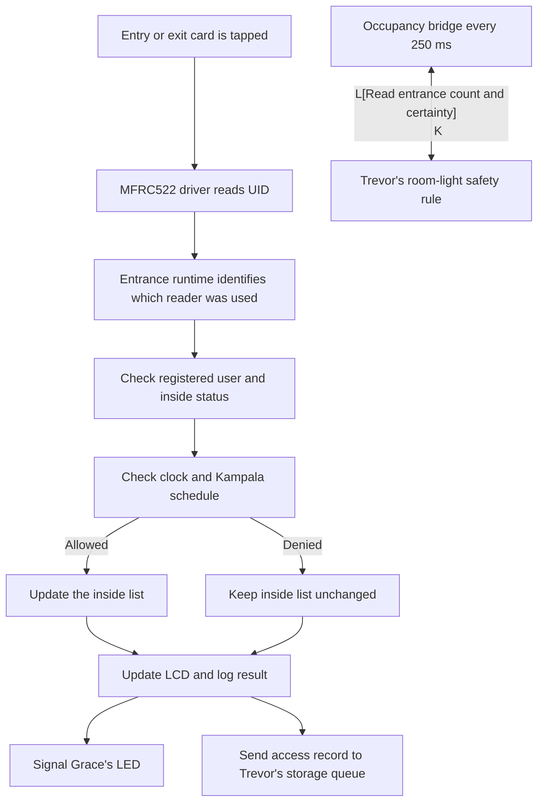

# Leon Nsitta Kalungi — entrance and access-control presentation

This guide is a speaking outline and code-reading aid for Leon's part of the
CoCIS system. It is written so the presentation can begin with the purpose,
then follow one card scan through the code and explain how the entrance shares
information with the other modules.

## 1. My part in one minute

> “I implemented the entrance access-control part of the system. It reads a
> card at the entry or exit reader, identifies the registered user, checks
> whether the person is already recorded inside, and checks the Kampala access
> schedule. If all rules pass, the system grants the scan and updates the
> inside list. If a rule fails, it denies the scan and leaves that person's
> inside status unchanged.
>
> “I also implemented the entrance display, administrator keypad, schedule
> handling, clock setup, and the connection that shares building occupancy
> with the room-control module. My part sends access results to the display,
> Grace's feedback LED, and the shared storage queue. The system uses one
> ESP32 in the Wokwi presentation circuit, so the room controllers are logical
> software modules in that simulation.”

## 2. What problem the entrance controller solves

The building needs to know who is allowed to enter and when entry and exit are
permitted. A card reader alone only returns an identifier. The entrance
controller adds the rules around that identifier:

1. Is this card in the enabled user list?
2. Is this user already recorded inside?
3. Is the clock synchronized, so the current time can be trusted?
4. Is the current time inside the configured access window?
5. If those checks pass, should this scan add the person to the inside list or
   remove them from it?

The inside count is calculated from the list of users whose `inside` value is
true. This is a logical count of successful card movements. It is not a sensor
that counts every person crossing the doorway.

## 3. One scan from the reader to the result

### The decision rules

| Example | Result | What happens to occupancy |
| --- | --- | --- |
| Enabled user taps the entry reader while the schedule is open | Grant entry | Their inside value becomes true. |
| Same user taps entry again without first leaving | Deny: anti-passback | No change. |
| Enabled user taps exit while recorded inside and the schedule is open | Grant exit | Their inside value becomes false. |
| User taps exit without a recorded entry | Deny: invalid exit | No change. |
| Card is not in the enabled roster | Deny: unknown user | No change. |
| Clock is not synchronized | Deny: clock unavailable | No change. |
| The current time is outside the schedule | Deny: schedule closed | No change, including at the exit door. |

This is called **fail closed**: when the system cannot prove that a scan is
allowed, it denies it. The schedule applies to both doors, so a person can
remain recorded inside after closing if an exit is denied. Staff must then
follow the building's real safety procedure; the software indicator is not a
physical lock.

## 4. Follow the code in presentation order

Show the files in this order. This follows the same path as the card scan and
keeps each explanation focused on one job.

### A. `components/entrance/mfrc522.c` — read the card

The MFRC522 driver communicates with both RFID modules over SPI. It initializes
the shared SPI bus and registers one device for each reader. Both devices share
the clock and data wires, but each has its own chip-select pin. The selected
chip-select tells the ESP32 which reader should respond.

The key public functions are:

- `mfrc522_init()` — prepare the reader devices and SPI connection.
- `mfrc522_poll(reader, uid, uid_size)` — check one reader and return the UID
  bytes when a card is detected.

The driver only reads a card identifier. The access rules are in a separate
file, so the hardware code does not decide whether a person is allowed in.

### B. `components/entrance/core.c` — apply the rules

This file contains the small, hardware-independent access rules. That makes
the rule logic easier to read and check without involving the LCD, keypad, or
Wi-Fi code.

- `entrance_state_init()` creates the initial state, demo users, and default
  08:00–18:00 schedule.
- `entrance_schedule_valid()` rejects impossible times and rejects a schedule
  whose opening and closing times are equal.
- `entrance_is_open()` checks whether the current local minute is inside the
  schedule. The opening minute is included and the closing minute is excluded.
  It also supports an overnight schedule such as 22:00–06:00.
- `entrance_apply_event()` checks the user, duplicate or old event number,
  entry/exit state, clock readiness, and schedule. It changes the `inside`
  value only when the decision is granted.
- `entrance_apply_scan()` creates the next event number and passes the scan to
  the same decision function.

The four cards on a clean install map to the group: Blue (`DE:AD:BE:EF`) is
Leon Nsitta Kalungi, Green (`11:22:33:44`) is Kato Trevor, Yellow
(`55:66:77:88`) is Kagimu Edward, and Red (`AA:BB:CC:DD`) is Ahurira Grace.
The short display names are Leon, Trevor, Edward, and Grace. A successful scan
briefly shows `Welcome <name>` at entry or `Goodbye <name>` at exit. The roster
can later be managed and saved by Edward's storage and CLI modules.

### C. `components/entrance/runtime.c` — connect the pieces

The runtime coordinates the reader, clock, rule logic, display state, and
event handoff. It owns the live entrance state: the enabled roster, inside
list, and active schedule.

The main functions to point out are:

- `entrance_runtime_start()` initializes the state and devices, loads the
  saved schedule, and starts the clock, RFID, schedule-monitor, display, and
  keypad work.
- `process_scan()` takes a UID from one reader, maps that reader to entry or
  exit, gets Kampala local time when available, calls the access rules, and
  prepares the result for the LCD, log, LED, and storage queue.
- `entrance_runtime_status()` gives other modules a safe snapshot of current
  entrance status.
- `entrance_runtime_set_schedule()` validates and saves an accepted schedule.
- `entrance_runtime_confirm_empty()` lets an administrator confirm that the
  building was physically checked after occupancy became uncertain.

The RFID task checks both readers about every 100 ms. It ignores a card that
remains held against the same reader so one tap does not create a stream of
duplicate scans. When a scan is denied, `process_scan()` records the reason but
does not change the inside list.

### D. `components/entrance/keypad.c` — operate the local admin menu

The keypad is implemented as a simple user-interface state machine. It has a
public screen, PIN entry, an administrator menu, and time-entry screens. The
keypad handles input and screen changes; it calls the shared authentication
and schedule functions instead of creating its own schedule.

For the demo:

1. Press `A` on the public screen.
2. Enter the four-digit presentation PIN `2468`, then press `#`.
3. Press `1` to change opening time or `2` to change closing time.
4. Enter four digits in `HHMM` format, then press `#`.
5. `*` clears the input; `D` cancels or logs out.

The keypad sends the PIN to the shared authentication module; it does not
implement its own PIN rules. The verifier uses PBKDF2-HMAC-SHA-256 with 1,000
rounds so it responds faster on the ESP32 demonstration target. Five incorrect
attempts trigger a one-minute lockout. An administrator session expires after
one minute. The four-digit PIN is for coursework and is not production-grade
security.

On the public screen, `B` marks a **simulated** tailgate event and makes
occupancy uncertain. It does not add a person to the inside list. `C` prints a
read-only roll-call to the USB serial log.

### E. `components/entrance/display.c` — show the status

The display module writes text to the 20-by-4 LCD. It does not decide access or
change the schedule. The runtime prepares the four lines, and the display
module sends them to the LCD over I2C. The runtime compares the new screen with
the previous screen and only redraws it when something changes.

The public screen can show clock synchronization, open/closed status, schedule
hours, the last result, inside count, occupancy uncertainty, or an after-hours
alert. “Waiting for RFID...” means no new card result has been displayed yet;
it does not itself mean the reader is broken. A card tap should produce a log
entry and update the display if a reader detected it.

After an administrator signs in with `A` and PIN `2468`, menu option `3` shows
the registered people and their current inside state, and option `4` pages
through up to eight latest scan attempts. The signed-in dashboard shows the
same roster and recent activity. This short list resets on reboot; the full
event archive is stored on SD and read with the serial `records` command.

### F. `components/entrance/dashboard.c` and the shared admin APIs

The Wi-Fi dashboard shows entrance status and offers an authenticated way to
change the schedule. The keypad, dashboard, and serial CLI call the same
schedule API. This prevents each interface from maintaining a different copy
of the opening and closing times.

The clock task connects to the Wokwi guest network and synchronizes time using
SNTP. The code uses the Africa/Kampala timezone. Until a valid time is
available, RFID access is denied because the schedule cannot be checked.

### G. `src/main.c` — share occupancy with room control

The combined presentation build starts the storage module, Trevor's room
runtime, Grace's LED interface, Leon's entrance runtime, and Edward's serial
menu. The `occupancy_bridge_task()` reads the entrance status every 250 ms and
passes both the inside count and whether that count is reliable to Trevor's
room runtime.

If the count is confirmed as zero, Trevor's room logic can force lights off.
After reboot or a simulated tailgate warning, occupancy is uncertain, so the
room logic must not treat an unknown count as proof that the building is empty.

## 5. How the schedule survives power loss

The active schedule is stored in ESP32 NVS under the `access_cfg` namespace.
For example, a closing time of 23:00 is saved as 1,380 minutes after
midnight. On startup, Leon's runtime loads that value again, so it remains the
active closing time after restart if the NVS commit succeeded.

When a schedule is changed, the system also asks the storage worker to append
an audit row to `/sdcard/events.csv` showing the old and new hours. The active
schedule is stored in NVS first; the SD row is its history record. If the SD
card is unavailable or the audit write fails, the schedule can still remain
active in NVS, but the system logs that the audit row was not confirmed.

Access results are also sent to the single storage worker, which writes
readable CSV rows and reports whether the write was confirmed. A power failure
can still interrupt a card transaction, so the current readable-row and
power-cycle behavior should be demonstrated live before claiming that exact
scenario has passed.

The live inside list is different: it is held in RAM and does not restore after
reboot. The system marks occupancy uncertain so an administrator can check the
building before using the “confirm empty” action. Do not claim that the SD
access log automatically reconstructs who is inside.

## 6. Pins used by my part

| Signal | GPIO | How to explain it |
| --- | ---: | --- |
| Shared SPI clock, MOSI, MISO | 18, 23, 19 | Common data wires for both RFID readers and the SD card. |
| Entry-reader chip select | 5 | Selects the entry reader on the shared SPI bus. |
| Exit-reader chip select | 13 | Selects the exit reader on the shared SPI bus. |
| RFID reset | 4 | Shared reset line for the two readers. |
| LCD SDA and SCL | 21, 22 | I2C data and clock wires for the display. |
| Keypad rows | 14, 15, 16, 17 | The ESP32 activates rows to find the pressed key. |
| Keypad columns | 34, 35, 36, 39 | The ESP32 reads these inputs; the diagram supplies pull-ups. |

Grace's blue feedback LED uses GPIO12 and is triggered through Grace's actuator
interface. The room sensors and lights are Trevor's area. For the complete
circuit table, use [`../INTERFACES.md`](../INTERFACES.md) and the wiring in
[`../../diagram.json`](../../diagram.json).

The GPIO list describes the Wokwi circuit. It is not a guarantee that the
same wiring is electrically suitable for a physical installation. GPIO2 and
GPIO12 affect ESP32 boot behavior, and the keypad input pins need external
pull-ups.

## 7. FreeRTOS and shared data in my part

FreeRTOS runs separate loops as tasks. In my part:

| Task | What it does |
| --- | --- |
| `entrance_clock` | Connects to Wi-Fi, synchronizes time, and maintains the clock-ready state; checks periodically, about every five seconds after sync. |
| `entrance_rfid` | Polls both readers about every 100 ms, applies access decisions, and sends the scan result to the other modules. |
| `entrance_schedule` | Checks about every 15 seconds whether the building has closed and reports people still recorded inside. |
| `entrance_lcd` | Checks about every 100 ms, builds the four LCD lines, and refreshes only when they change. |
| `entrance_keypad` | Scans the keypad about every 40 ms and processes public/admin menu actions. |

A **mutex** is a lock that protects shared values while a task reads or updates
them. The entrance mutex protects the schedule, user list, and inside list.
The code releases that mutex before slow storage work so a card scan does not
hold the shared entrance state locked while the SD card is written.

A **queue** is a first-in, first-out message line between tasks. Leon sends an
access record to Trevor's storage queue; the storage worker is the single task
that writes event rows to the SD card. Room-state logging is asynchronous.
Access and schedule audit requests wait up to five seconds for a storage
result, but the active schedule remains in NVS if the SD audit cannot be
confirmed.

The entrance's occupancy bridge shares a count and a certainty flag. That flag
matters: a count of zero is useful only when the system knows that the count is
reliable. Unknown occupancy is not treated as empty occupancy.

## 8. A clear demo sequence

Before presenting, start the combined `esp32dev` build and wait for the LCD to
show the clock/schedule screen. The default schedule is 08:00–18:00 Kampala
time. Have the demo UIDs and the current simulated time in mind.

1. **Introduce the display.** Point out the open/closed status, schedule, and
   inside count. If it says `TIME SYNC...`, wait for SNTP before scanning.
2. **Show one successful entry.** Tap an enabled demo card at the entry
   reader during the open window. Blue is Leon, Green is Trevor, Yellow is
   Edward, and Red is Grace. The LCD briefly says `Welcome` plus that member's
   call name and updates the count.
3. **Show anti-passback.** Tap the same card at entry again without exiting.
   Explain why the second scan is denied and the count remains unchanged.
4. **Show the exit path.** Tap that card at the exit reader. The LCD briefly
   says `Goodbye` and the person's call name; explain that the inside count
   returns to its earlier value.
5. **Show the admin roster and activity lists.** Press `A`, enter PIN `2468`,
   then press `3` for the roster or `4` for recent scans. Use `A`/`B` to move
   between pages and `D` to return to the admin menu. The dashboard shows both
   lists after sign-in. It shows the roster's full names and current state; the
   recent list includes up to eight scans from the current boot.
6. **Show schedule administration if time permits.** Use `A`, PIN `2468`,
   `#`, then `2`; enter a valid closing time in `HHMM` format and press `#`.
   The LCD shows a checking message while authentication and saving happen.
7. **Explain persistence honestly.** The schedule is kept in NVS and a change
   is audited on SD. A power-cycle check of the latest readable event rows
   should only be called passed if it has just been demonstrated.

If the simulated time is outside the access window, the expected behavior is
denial. Explain that the schedule rule is working; do not call it an RFID
failure. Use the current demo schedule/time or the prepared Wokwi scenario to
show a grant during the access window.

The completion plan records an earlier Wokwi run that granted an entry and
exit and returned the count to zero. That run used the previous compact SD row
format. The after-hours scenario also recognized the registered card and
denied access while closed, then rejected an unknown card. Rerun the current
scenario if you want to show the latest readable CSV format or reboot
persistence; do not describe those newer checks as passed until they have been
observed.

## 9. Questions the lecturer may ask

**Why do you use two readers?**

The reader number tells the software whether the scan is an entry or exit
request. The readers share SPI data wires but use separate chip-select pins.

**What is a UID?**

It is the identifier byte sequence reported by the RFID card. The program
compares those bytes with the enabled roster; the UID alone is not a person's
name.

**How do you stop someone entering twice?**

After a granted entry, the person is marked inside. A second entry is rejected
until a granted exit marks that person outside.

**How does the system know how many people are inside?**

It counts the enabled users whose entry was granted and whose exit has not
been granted. It does not detect tailgating, so the number can differ from the
real headcount.

**What happens if the clock or Wi-Fi is unavailable?**

The system denies access because it cannot confirm whether the schedule allows
the scan. It fails closed.

**Does changing the schedule save it to the SD card?**

The active schedule is committed to NVS so it can be restored after reboot.
The SD card receives a separate audit row containing the old and new hours.
If the SD write fails, the NVS schedule can still be active and the firmware
reports that the audit row was not confirmed.

**Does occupancy return after reboot?**

No. The inside list is in RAM. At startup occupancy is marked uncertain, and
an authorized person must check the building before confirming that it is
empty.

**Is the tailgate warning automatic?**

No. Keypad `B` is a simulation-only marker. A real tailgate detector would
need a passage sensor or another suitable physical device.

**Does the blue LED unlock the door?**

No. It only gives a short or long visual pulse for scan feedback. The Wokwi
model has no real lock actuator.

## 10. Terms to explain simply

- **SPI:** a shared set of wires used to communicate with devices such as the
  RFID readers and SD card. Chip-select chooses one device at a time.
- **I2C:** the two-wire bus used by the LCD.
- **NVS:** ESP32 non-volatile settings storage that keeps values through a
  restart, such as the active schedule.
- **SD event log:** an append-only file used to keep event history when the
  card is available.
- **FreeRTOS task:** one activity that the ESP32 scheduler runs alongside
  other activities.
- **Mutex:** a lock used to prevent tasks changing shared data at the same
  time.
- **Queue:** an ordered message buffer used to pass work to another task.
- **Anti-passback:** reject repeated entry while the same person is still
  recorded inside.
- **Fail closed:** deny access when an important check, such as the clock, is
  unavailable.
- **Occupancy uncertainty:** the system cannot trust its live inside count
  until a person checks the building and confirms the state.

## 11. Closing statement

> “My entrance module turns an RFID identifier into a controlled access
> decision. It checks identity, entry/exit state, time, and the shared
> schedule, then reports the result to the display, feedback LED, occupancy
> bridge, and event-storage queue. The main limits are that occupancy depends
> on card scans, the tailgate marker is simulated, and the Wokwi outputs do not
> operate real doors or building lights.”

For the complete project view, see the [system operation
report](../SYSTEM_OPERATION_REPORT.md), [code walkthrough](../CODE_WALKTHROUGH.md),
[module integration guide](../MODULE_INTEGRATION_GUIDE.md), and
[presentation demo](../PRESENTATION_DEMO.md).
